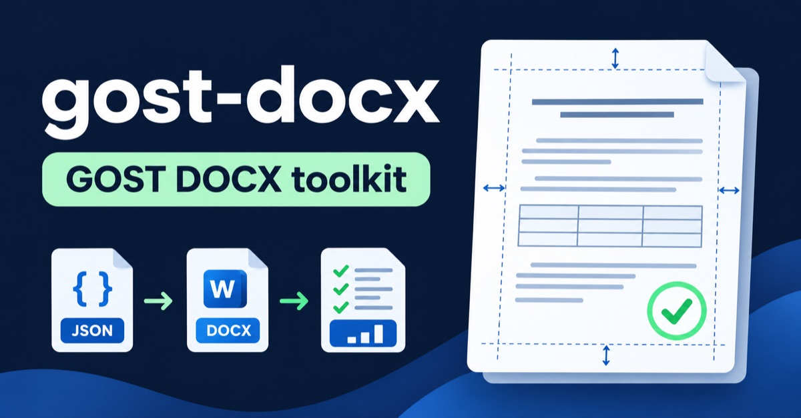

# gost-docx

**Проверяй. Форматируй. Собирай DOCX по ГОСТ.**

[](https://github.com/optMD/gost-docx/actions/workflows/validate.yml)
[](https://github.com/optMD/gost-docx/releases)
[](LICENSE)
[](.github/workflows/validate.yml)
[](.github/workflows/validate.yml)

[Установка](#установка-skill) · [Быстрый старт](#быстрый-старт) · [Примеры](examples/) · [Архитектура](docs/architecture.md) · [Разработка](#разработка-и-релизы)

`gost-docx` — переиспользуемый Agent Skill и набор локальных инструментов для работы с Word-документами (`.docx`) по ГОСТ 7.32-2017, ГОСТ Р 7.0.100-2018 и предоставленным пользователем методичкам.




## Зачем это нужно

Оформление отчёта вручную — это много повторяющихся проверок и легко пропустить мелкую, но важную деталь. `gost-docx` выносит механику документа в воспроизводимый workflow:

```text
JSON-спецификация ──▶ новый DOCX ──▶ форматированная копия ──▶ аудит
                                           │
                                           └── Markdown-отчёт
```

При этом содержание остаётся авторским: инструмент не дописывает работу за пользователя.

## Возможности

| Сценарий | Результат |
| --- | --- |
| Аудит | Читаемый Markdown-отчёт о найденных нарушениях |
| Форматирование | Копия `*_gost.docx`, исходный файл не изменяется |
| Генерация | Новый DOCX из структурированной JSON-спецификации |
| Профили | Базовый ГОСТ и явные пользовательские методички |
| Структура | Титульный лист, содержание, главы, источники и приложения |
| Ссылки | Проверка порядка ссылок и связывание с библиографией |

Проверяются формат страницы, поля, шрифт, размер, интервалы, абзацы, колонтитулы, нумерация, заголовки, подписи, маркеры списков, ссылки и структура документа.

## Установка skill

### Codex, Claude Code и другие агенты

Установка во все обнаруженные агенты глобально:

```bash
npx skills add https://github.com/optMD/gost-docx \
  --skill gost-docx \
  --agent '*' \
  --global \
  --yes
```

Только в Codex и Claude Code:

```bash
npx skills add https://github.com/optMD/gost-docx \
  --skill gost-docx \
  --agent codex \
  --agent claude-code \
  --global \
  --yes
```

Проверить установку и обновить skill:

```bash
npx skills list
npx skills update
```

Для установки только в текущий проект убери флаг `--global`. Подробности, включая пути для разных агентов и ручную загрузку в Claude.ai, описаны в [docs/installation.md](docs/installation.md).

Для локальной разработки клонируй репозиторий и установи Node-зависимости:

```bash
git clone https://github.com/optMD/gost-docx.git
cd gost-docx
npm ci --prefix scripts
```

Нужны Python 3, `lxml`, Node.js и npm. Для аудита и форматирования используется Python, для генерации нового документа — Node.js и пакет `docx`.

## Быстрый старт

### 1. Проверить существующий документ

```bash
python3 scripts/gost_docx.py audit report.docx --out audit.md
```

Аудит только читает исходный файл. Коды возврата:

| Код | Значение |
| ---: | --- |
| `0` | Ошибок не найдено |
| `1` | Документ открыт, найдены замечания |
| `2` | Документ не удалось открыть |

### 2. Отформатировать копию

```bash
python3 scripts/gost_docx.py format report.docx
```

Результат появится рядом с исходным файлом как `report_gost.docx`. Оригинал не перезаписывается.

### 3. Создать документ из JSON

```bash
python3 scripts/gost_docx.py build task.json report.docx
```

Минимальная спецификация:

```json
{
  "profile": "report",
  "introduction": ["Текст предоставлен автором."],
  "chapters": [
    {
      "heading": "1 Основной раздел",
      "paragraphs": ["Текст раздела предоставлен автором."],
      "subsections": []
    }
  ],
  "conclusion": ["Заключение предоставлено автором."],
  "sources": [],
  "appendices": []
}
```

Поддерживаются поля `profile`, `abstract`, `keywords`, `introduction`, `chapters`, `conclusion`, `sources` и `appendices`. Содержательные поля копируются из JSON и не генерируются автоматически.

Полный пример с готовым запуском всех трёх сценариев находится в [`examples/`](examples/).

## Что именно делает skill

### Титульный лист

Если готовый титульный лист не предоставлен, создаётся нейтральная заглушка:

```text
ТИТУЛЬНЫЙ ЛИСТ
```

Страница входит в общий счёт, но её видимый номер скрыт. Существующий титульный лист сохраняется.

### Профили и конфликты

Базовые источники — ГОСТ 7.32-2017 и ГОСТ Р 7.0.100-2018. Пользовательская методичка может расширять или переопределять структуру выбранного профиля.

Если правила расходятся, skill показывает конфликт и просит выбрать вариант. Требования методички не выдаются молча за требования ГОСТ.

### Границы ответственности

Инструмент не придумывает:

- персональные данные;
- текст работы, результаты и выводы;
- библиографические записи;
- отсутствующие сведения об источниках;
- факты, измерения или утверждения.

## Покрытие проверками

| Область | Статус |
| --- | --- |
| A4/A3, ориентация и поля | ✅ |
| Times New Roman, размер, отступы и интервалы | ✅ |
| Нижний колонтитул и нумерация страниц | ✅ |
| Заголовки, подписи и маркеры списков | ✅ |
| Порядок ссылок на источники | ✅ |
| Структурные элементы и приложения | ✅ |
| Формулы и визуальный рендер | ручная проверка |

## Архитектура

Потоки данных и границы между генерацией, форматированием и аудитом описаны в [архитектурной схеме](docs/architecture.md).

## Ограничения

- формулы и визуальный результат после рендера требуют ручной проверки;
- содержание Word нужно обновить в Microsoft Word после генерации;
- сложные таблицы и нестандартные титульные листы могут потребовать ручной доработки;
- аудит проверяет только правила, реализованные в `scripts/audit_docx.py`, и не заменяет финальную проверку оформления человеком.

## Структура репозитория

```text
SKILL.md                         инструкции Agent Skill
references/gost-rules.md         правила ГОСТ и решения проекта
scripts/audit_docx.py            аудит существующего DOCX
scripts/apply_gost.py            форматирование копии DOCX
scripts/build_gost.js            генерация нового DOCX
examples/                         воспроизводимый end-to-end пример
tests/                            регрессионные тесты и фикстуры
docs/architecture.md              схема потоков данных
docs/installation.md              установка в AI-агенты
docs/demo.svg                     визуальная схема workflow
.github/workflows/validate.yml   обязательная CI-проверка
CODE_OF_CONDUCT.md                кодекс поведения
CITATION.cff                      метаданные для цитирования
```

## Проверка изменений

Локальный эквивалент CI:

```bash
npm ci --prefix scripts
python3 -m pip install lxml
python3 -m compileall -q scripts tests
node --check scripts/build_gost.js
python3 -m unittest discover -s tests -v
git diff --check
```

При изменениях, влияющих на страницы, таблицы, подписи, колонтитулы или нумерацию, дополнительно проверь результат через LibreOffice.

## Разработка и релизы

Изменения проходят через сфокусированные ветки и pull request. Независимые изменения оформляются отдельными коммитами, сообщения коммитов пишутся на английском языке в повелительной форме, а изменения поведения сопровождаются регрессионными тестами.

- [CONTRIBUTING.md](CONTRIBUTING.md) — правила разработки;
- [CHANGELOG.md](CHANGELOG.md) — история изменений;
- [SECURITY.md](SECURITY.md) — сообщение об уязвимостях;
- [CODE_OF_CONDUCT.md](CODE_OF_CONDUCT.md) — кодекс поведения;
- [CITATION.cff](CITATION.cff) — сведения для цитирования;
- [последний релиз](https://github.com/optMD/gost-docx/releases/latest);
- [английская версия README](README_ENG.md).

## Лицензия

[MIT License](LICENSE).
