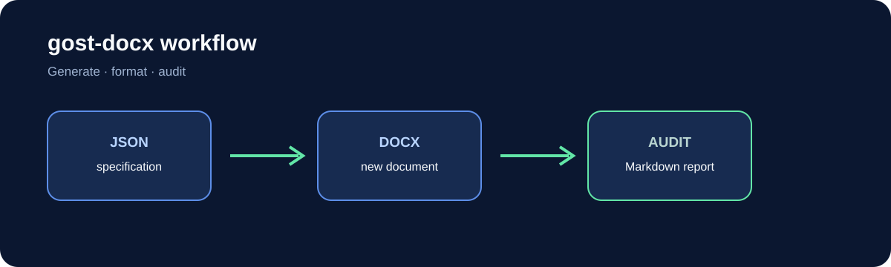

# gost-docx

[](https://github.com/optMD/gost-docx/actions/workflows/validate.yml)
[](https://github.com/optMD/gost-docx/releases)
[](LICENSE)

[Installation](#installation-for-ai-agents) · [Quick start](#quick-start) · [Examples](examples/) · [Architecture](docs/architecture.md)

Reusable skill for creating, auditing, and formatting Word documents (`.docx`) against GOST requirements and user-provided institutional guidelines.

`gost-docx` separates document mechanics from document content. It configures layout, structure, and validation without inventing text, sources, conclusions, or personal data.



## Features

- read-only audit of an existing `.docx`;
- safe copy formatting with the `_gost.docx` suffix;
- new document generation from user-provided JSON;
- GOST 7.32-2017 and GOST R 7.0.100-2018 support;
- explicit profiles for user-provided institutional guidelines;
- neutral title-page placeholder without personal data;
- continuous page numbering with the title-page number hidden;
- updateable Word table of contents;
- chapters, subsections, sources, and appendices;
- links from in-text citations to bibliography entries.

## Installation for AI agents

Install globally for all detected agents:

```bash
npx skills add https://github.com/optMD/gost-docx \
  --skill gost-docx \
  --agent '*' \
  --global \
  --yes
```

Install only for Codex and Claude Code:

```bash
npx skills add https://github.com/optMD/gost-docx \
  --skill gost-docx \
  --agent codex \
  --agent claude-code \
  --global \
  --yes
```

Verify and update:

```bash
npx skills list
npx skills update
```

See [docs/installation.md](docs/installation.md) for project-local installation, agent paths, and Claude.ai upload notes.

## Quick start

### Audit

```bash
python3 scripts/audit_docx.py report.docx --out audit.md
```

Exit codes are `0` for no errors, `1` for findings, and `2` when the document cannot be opened.

### Format a copy

```bash
python3 scripts/apply_gost.py report.docx
```

The source file is preserved and the result is written next to it as `report_gost.docx`.

### Generate a document

```bash
npm ci --prefix scripts
NODE_PATH=scripts/node_modules node scripts/build_gost.js task.json report.docx
```

Example specification:

```json
{
  "profile": "report",
  "introduction": ["Text supplied by the author."],
  "chapters": [
    { "heading": "1 Main section", "paragraphs": ["Author-supplied text."], "subsections": [] }
  ],
  "conclusion": ["Conclusion supplied by the author."],
  "sources": [],
  "appendices": []
}
```

Supported fields are `profile`, `abstract`, `keywords`, `introduction`, `chapters`, `conclusion`, `sources`, and `appendices`.

A complete reproducible example is available in [`examples/`](examples/). It runs one JSON specification through generation, copy formatting, and audit.

## Behavior and safety

The default baseline is GOST 7.32-2017 with bibliographic descriptions from GOST R 7.0.100-2018. User-provided guidelines can extend or override profile-specific structure. Conflicts are shown to the user instead of being resolved silently.

The skill never invents personal data, report text, conclusions, bibliography entries, measurements, results, or missing source metadata.

When no title page is supplied, the generated document uses `ТИТУЛЬНЫЙ ЛИСТ`. The page is counted but its visible number is hidden. Existing title pages are preserved.

## Repository layout

```text
SKILL.md                         Agent instructions and workflow
references/gost-rules.md         GOST rules and project decisions
scripts/audit_docx.py            Read-only DOCX audit
scripts/apply_gost.py            Formatting of a DOCX copy
scripts/build_gost.js            New DOCX generator
tests/                            Regression tests and fixtures
.github/workflows/validate.yml   CI validation workflow
examples/                        Reproducible end-to-end example
docs/architecture.md             Data-flow architecture diagram
docs/installation.md             Installation for AI agents
docs/demo.svg                    Workflow illustration
CHANGELOG.md                     Change history
SECURITY.md                      Security policy
CODE_OF_CONDUCT.md               Code of conduct
CITATION.cff                     Citation metadata
LICENSE                          MIT License
README.md                        Russian documentation
```

## Supported checks

| Area | Status |
| --- | --- |
| A4/A3 page size and margins | ✅ |
| Fonts, size, indents, and spacing | ✅ |
| Footer and page numbering | ✅ |
| Headings, captions, and list markers | ✅ |
| Citation order | ✅ |
| Document structure and appendices | ✅ |
| Formulas and rendered visual layout | manual review |

## Limitations

- formulas and rendered visual output require manual review;
- the Word table of contents must be updated in Microsoft Word after generation;
- complex tables and non-standard title pages may require manual refinement;
- the audit covers only rules implemented in `scripts/audit_docx.py`.

## Validation

```bash
npm ci --prefix scripts
python3 -m pip install lxml
python3 -m compileall -q scripts tests
node --check scripts/build_gost.js
python3 -m unittest discover -s tests -v
git diff --check
```

Inspect rendered output with LibreOffice when a change affects pagination, tables, captions, headers, footers, or numbering.

## Development

Use focused branches and pull requests. Keep independent behavior changes in separate commits, write commit messages in English using imperative subjects, and add regression tests for behavior changes.

See [CONTRIBUTING.md](CONTRIBUTING.md) for the contribution workflow.

See [CODE_OF_CONDUCT.md](CODE_OF_CONDUCT.md) for community guidelines and [CITATION.cff](CITATION.cff) for citation metadata.

For the primary Russian documentation, see [README.md](README.md).
