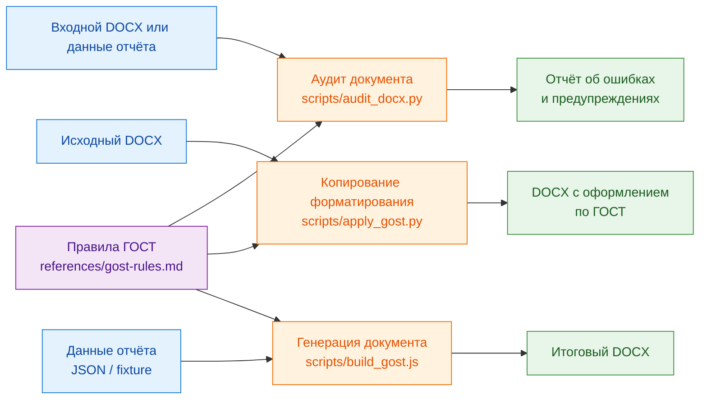

# Архитектура проекта

Диаграмма показывает основные потоки обработки документов: аудит, копирование форматирования и генерацию отчёта.

## Потоки

- **Аудит:** входной DOCX проверяется скриптом `audit_docx.py` по правилам ГОСТ; результатом становится отчёт об ошибках и предупреждениях.
- **Копирование форматирования:** исходный DOCX и правила ГОСТ передаются в `apply_gost.py`, который возвращает оформленный документ.
- **Генерация:** данные отчёта и правила ГОСТ используются `build_gost.js` для создания итогового DOCX.
